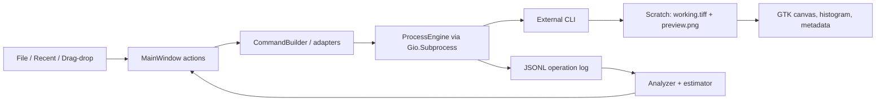

# Astro Studio

A zero-processing GTK desktop front-end for astronomical and photographic CLI
backends (current version **0.2.33**). The GUI loads and displays images, collects parameters, builds sanitized
`argv` vectors, spawns external tools asynchronously, and renders the files those
tools wrote. It never implements calibration, stacking, demosaicing, stretching or
any other pixel algorithm.

## Requirements

- Linux/Ubuntu with GTK **3.24** and PyGObject (`python3-gi`, `gir1.2-gtk-3.0`,
  `gir1.2-gdkpixbuf-2.0`).
- Python 3.8 or newer.
- Optional external binaries: `magick`, `gm`, `exiftool`, `rawtherapee-cli`,
  `darktable-cli`, `siril-cli`, `astap_cli`, `solve-field`, `gimp`, etc. Only the
  connectors installed on the host are enabled in the menu.
- `pytest` for the automated checks.

From the project root:

```bash
sudo apt install python3-gi gir1.2-gtk-3.0 gir1.2-gdkpixbuf-2.0 imagemagick libimage-exiftool-perl
```

## Architecture



## Run

```bash
python3 -m astrostudio
```

## Install as a desktop application

The installer is user-level (no `sudo`) and registers a launcher, icon and desktop
entry under `$XDG_DATA_HOME` (`~/.local/share` by default):

```bash
./packaging/install.sh
```

It installs `astro-studio.desktop` in `applications/`, the scalable SVG icon and
rasterized PNG sizes in `icons/hicolor/`, registers the image MIME types (PNG,
JPEG, TIFF, BMP, WebP, FITS, CR2, NEF, ARW), refreshes the desktop and icon caches,
and points the launcher at `packaging/astro-studio`. After installation, search for
**Astro Studio** in the application menu, right-click an image and choose *Open With
Other Application > Astro Studio*, or run:

```bash
gtk-launch astro-studio
```

To verify the installation: `desktop-file-validate ~/.local/share/applications/astro-studio.desktop`.

On startup the app probes every connector binary for installation and version. The
**Backends** panel lists the result, and menu actions are enabled only when their
backend is installed and an adapter exists. A missing binary leaves the action
visible but disabled; no in-process fallback is ever attempted. ImageMagick is
detected as `magick` (v7) or `convert` (v6). The Backends panel can be closed with its
X button and restored from *View > Toggle Backends Viewer*.

## Dual-format image workflow

Every opened image is prepared in scratch as two files:

1. `working.tiff` — 16-bit, high-depth image used by **all** external CLI
   transformations.
2. `preview.png` — 8-bit display copy generated from that TIFF; this is the only file
   the GUI renders on the canvas.

When you apply a transform (resize, unsharp, crop, rotate), an external CLI tool
operates on the TIFF and writes a new TIFF. The new TIFF replaces the previous one
and a fresh PNG is generated from it; the GUI then reloads that PNG while preserving
the current zoom and scroll position. Original inputs are never modified.

The **Metadata** panel on the right is hidden until you press the (i) Metadata button;
it then shows two tabs (PNG preview and TIFF working) filled by ExifTool, and can be
closed with its X button. The **Terminal Drawer** logs each CLI invocation with date,
time, full `argv` and the backend's response/exit code; it no longer repeats backend
installation status or metadata output, and scrolls to the newest line automatically.
It has its own X button and can be restored from *View > Toggle Terminal Drawer*.
Scroll the mouse wheel over the preview to zoom; drag with the left mouse button to pan
when the image is larger than the window. Transforms and Undo/Redo keep the same zoom
and pan position. A watch cursor is shown for the whole job lifecycle. The Backends
panel lists installed connectors first (alphabetically), then the missing ones, and its
View toggle stays enabled after closing the panel with X. FITS/RAW sources take the
RGB HDUs are combined into one RGB TIFF and get a CLI display stretch for the PNG
preview; exports stay linear. *Options > Backend Settings* persists enabled connectors,
language, theme, offline mode and thread limit under `$XDG_CONFIG_HOME`; the theme is
actually applied to GTK (Yaru/Adwaita light or dark). View-menu toggles show On/Off,
and the status bar always shows the active PNG/TIFF sizes plus transform/export time.
CPU/RAM level bars in the right dock refresh once per second (`psutil`, `/proc` fallback).
Every CLI job and GUI operation is appended to an incremental JSONL log under
`$XDG_DATA_HOME/astro-studio/operations.jsonl`. View > Histogram fills the docked panel
between CPU/RAM and the Terminal with CLI-generated distributions (bounded to 256 colours
for speed). Drag its two handles to set low/high cut points: the CLI regenerates only the
preview PNG with `-level`, leaving the high-depth TIFF untouched. The CPU bar shows both
overall and peak-core usage.

## Benchmarks and time estimates

```bash
PYTHONPATH=. python3 tests/benchmark_operations.py
PYTHONPATH=. python3 scripts/analyze_operations.py
```

The benchmark generates images up to 20 MP, opens them, applies filters and exports to
several formats, appending timed events to the operation log. The analyzer writes
`~/.local/share/astro-studio/operations.csv` and incrementally updates
`estimates.json`; the GUI uses that model to show an estimated duration and a green
progress bar in the status area before each operation.

## Astrometry (SkyStacker bridge)

The **Astrometry** menu delegates to the installed SkyStacker CLI and writes all
results to scratch:

- **Plate Solve...** optionally asks for an RA/Dec seed (decimal degrees) and runs the
  WCS-capable `--image-op sky-map --plate-solve` path. On success SkyStacker writes
  `<base>_plate_solution.json`; Astro Studio normalises it to `plate_solution.json`,
  caches it for the image and shows the reported field of view / centre.
- **Gaia Sky Map...** reuses that cached solution (or solves again) and runs
  `--image-op sky-map` to produce a Gaia catalog SVG, converted to PNG by the external
  CLI and displayed.
- **Survey Cutout...** likewise reuses the solution and runs `--image-op survey-cutout`
  to fetch a HiPS FITS cutout of the same sky area.

These need a real star field and, for catalog/survey data, Gaia/HiPS access (offline
caching is supported by the backend). If star matching fails, the CLI error is shown
instead of a false "OK" report; `measure-quality` alone never produced a plate solution.
A reproduced failure with uncalibrated wide-field JPGs (`0 matched pairs`) occurs in
SkyStacker itself when its CLI is run outside AstroStudio, so alternative solvers are
planned in the roadmap.

## Export formats

*File > Export / Save As* first asks for the output format, then for the destination
and name. Available formats are generated by the external CLI from the working TIFF:

- Scientific: TIFF 16-bit uncompressed/LZW/Zip, TIFF 32-bit float, FITS 16-bit and
  32-bit float, PNG 16-bit.
- Display: PNG 8-bit, JPEG 8-bit at 90% or 95% quality, BMP 8-bit, flattened PSD.

The chosen extension is enforced on the destination path. The suggested name is the
current image name; `-1`, `-2`, ... is added only if the exact file already exists.
The status bar reports size and elapsed time after a successful export. PNG is copied
from the regenerated preview; every other format is written by the external backend.

## Automated tests

```bash
python3 -m compileall -q astrostudio tests
PYTEST_DISABLE_PLUGIN_AUTOLOAD=1 python3 -m pytest tests/ -q
```

`PYTEST_DISABLE_PLUGIN_AUTOLOAD=1` is required in this environment because an
unrelated Dash plugin breaks pytest's autoload. The suite covers `argv`
serialization, adapter flag mapping, scratch isolation, process lifecycle
(missing binary and exit codes) and startup backend gating.

## Manual verification

1. **Startup discovery:** check the Backends panel; the terminal drawer only shows CLI
   calls and responses. `ExifTool`, `GIMP` and ImageMagick 6 (`convert`) are detected.
   Close the Backends panel with its X and restore it from View > Toggle Backends Viewer.
2. **Open a file:** `Ctrl+O` (or the Open toolbar button) and select PNG, JPG/JPEG,
   TIFF, FITS, BMP, CR2/CR3, NEF, ARW or DNG (uppercase extensions included; an
   "All files" filter is also available). The log shows the generated `working.tiff`
   and `preview.png`; the canvas renders the PNG only.
3. **Metadata:** `Ctrl+I` or the (i) toolbar button opens the Metadata panel with two
   tabs (PNG preview and TIFF working) filled by ExifTool; close it with its X.
4. **Display zoom:** double-click the image (or press the fit button) to fit it to
   the window; the mouse wheel zooms and left-drag pans. Fit to Window remains in View.
5. **Transform via CLI:** Processing > Resize Image offers 10/25/50/75/100/150/200/
   400/1000% plus Custom Scale; Processing > Sharpen offers light/medium/strong presets.
   The GUI generates the CLI flags, transforms the working TIFF, replaces it and
   regenerates the PNG preview. No parameter inspector is involved. *Edit > Undo / Redo* restores the previous
   TIFF and PNG snapshots.
6. **Export via CLI:** File > Export / Save As asks for the format first, then the
   destination and writes the chosen artifact from the current working TIFF. If the
   action is disabled, the terminal drawer explains why instead of failing silently.
7. **Open With:** right-click a PNG/FITS file, choose Astro Studio, and confirm the
   image is loaded with its TIFF+PNG workspace.
8. **Panels:** close the Terminal Drawer with its X and restore it from View > Toggle
   Terminal Drawer; the log always scrolls to the newest CLI response.
9. **Astrometry:** with a real star-field image, run Astrometry > Plate Solve, Gaia Sky
   Map and Survey Cutout; inspect the reported FOV and generated artifacts.
10. **Quit:** `Ctrl+Q` cleans up the scratch directory.
11. **Backend settings:** Options > Backend Settings writes the detected version list
   to the terminal drawer.

## Layout

- `astrostudio/app.py` — application, actions, accelerators, startup discovery.
- `astrostudio/core/` — command builder, async process engine, scratch manager,
  backend registry, dual-format `image_workspace.py`.
- `astrostudio/adapters/` — CLI connectors (ImageMagick, ExifTool).
- `astrostudio/ui/` — GTK window, menus, metadata/log panels and preview canvas; CLI
  parameters are generated internally from menu/dialog choices, not typed by users.
- `tests/` — unit and lifecycle tests.
- `packaging/` — SVG icon, `.desktop` template, launcher script and user-level installer.
- `Context/` — authoritative specifications and living AI project context.
- `roadmap.md` — milestones v0.1.0 to v1.0.0.

## Conventions

Original input files are never modified. All intermediate files live under
`<XDG_RUNTIME_DIR>/astro-studio/<session>/<job>/` (fallback
`/tmp/astro_studio_<pid>/`). CLI calls use `argv` arrays only; no shell strings and
no blocking calls on the GTK main thread.

Version control is on `main`; commit logical changes with English messages, update
`Context/AstroStudio_ai_project_context.md` and `roadmap.md` when status changes,
and never push without an explicit request.
